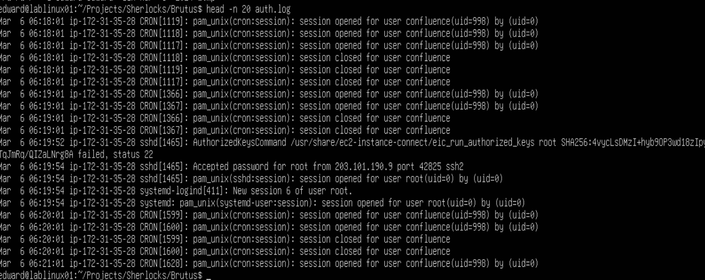
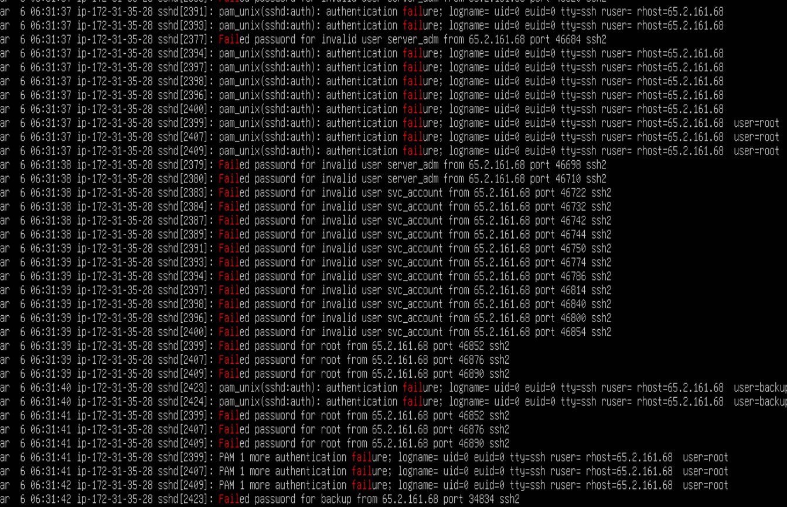
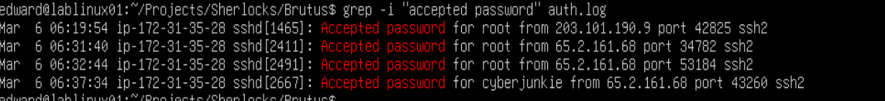
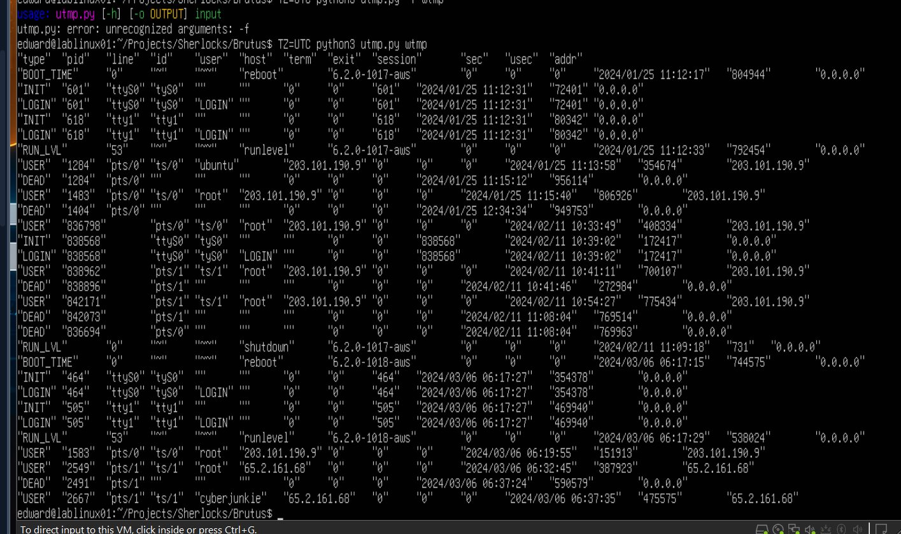
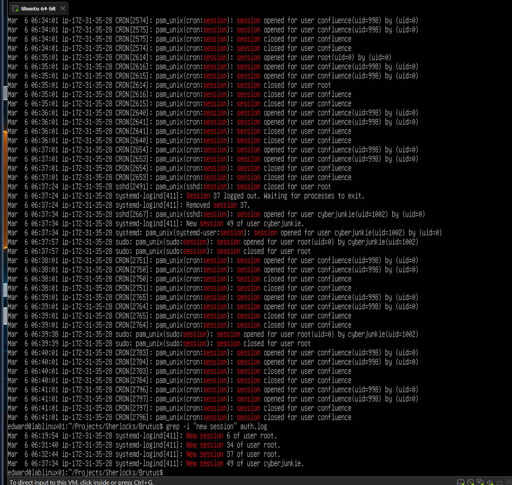
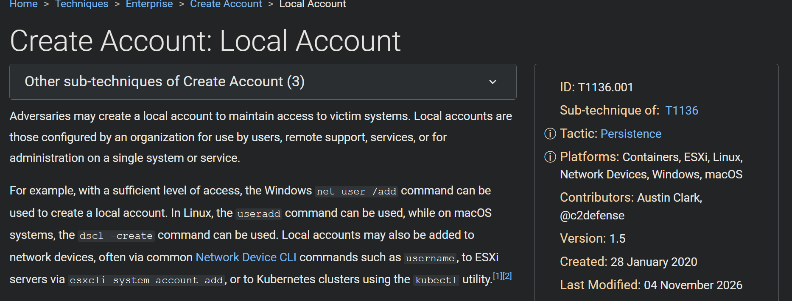
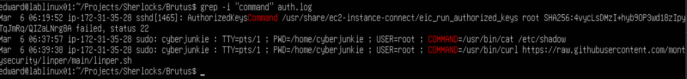

# Linux SSH Incident Response Investigation

## Project Overview

For this project, I completed Brutus, a retired Hack The Box Sherlock that focuses on investigating a compromised Confluence server following an SSH brute-force attack. The goal was to work through the available forensic evidence to understand how the attacker gained access to the server, what they did after gaining access, and how they attempted to maintain it. I completed the investigation in my Ubuntu virtual machine, primarily working with Linux authentication logs and binary login records. I wanted to use this lab to get more comfortable investigating security incidents from the command line and build on my previous experience working with Linux systems and authentication logs.

## Tools and Environment

- VMware Workstation
- Ubuntu Linux
- Windows 11
- Python 3
- 7-Zip
- Linux command-line utilities
- MITRE ATT&CK Framework
- Hack The Box Sherlocks

## Forensic Artifacts

| Artifact | Purpose |
|---|---|
| `auth.log` | Contains authentication attempts, SSH activity, account changes, and sudo command records. |
| `wtmp` | Binary file containing historical login and logout records. |
| `utmp.py` | Python script provided with the lab to parse binary login records. |

## Investigation Process

### 1. Evidence Preparation and Initial Log Analysis

I started by setting up a shared folder in VMware to transfer the provided files from my Windows host to my Ubuntu virtual machine. After creating a directory for the investigation, I extracted the files using 7-Zip because the standard unzip utility did not support the archive's encryption method. Before searching for anything specific, I used the head command to look at the first 20 lines of auth.log and get familiar with how the information was recorded. The log contained CRON jobs, SSH authentication attempts, PAM records, and systemd login sessions. Since the incident involved SSH, I knew that most of my initial investigation would revolve around entries associated with sshd.

```bash
head -n 20 auth.log
```



### 2. Identifying the SSH Brute-Force Attack

My first objective was to identify where the brute-force attempts were coming from. I used grep to search for authentication failures, eventually broadening my search to include different variations of the word fail using the -i flag. This made it easier to identify both failed password attempts and authentication failure messages. What stood out was the number of attempts coming from 65.2.161.68 within just a few seconds. The attempts were also targeting different usernames, including root, backup, server_adm, and svc_account. Seeing the same IP address repeatedly attempting to authenticate against multiple accounts in such a short period was a strong indication of automated brute-force activity.

```bash
grep -i "fail" auth.log
```



### 3. Identifying the Compromised Account

Once I identified the source of the brute-force attempts, I wanted to see whether the attacker had actually managed to log in. I searched for accepted password entries and compared their source IP addresses with the IP address from the previous step. The results confirmed that the attacker had successfully authenticated as root, meaning they had gained access to an account with full administrative privileges on the server. I also noticed a successful login from the same IP address under a different username, cyberjunkie, which was something I would come back to later in the investigation.

```bash
grep -i "accepted password" auth.log
```



### 4. Analyzing Binary Login Records

This was probably one of the more interesting parts of the lab because I had not previously worked with wtmp files. I needed to find out when the attacker established an interactive terminal session, which is not necessarily the same time as successful authentication. Since wtmp is a binary file, I initially tried using the last command, but it was not available on my Ubuntu installation. The lab included a Python script for parsing the file, so I looked through the script to understand how it handled the records before running it. I noticed that it used the system's local timezone when displaying timestamps, so I specified UTC when executing it. From the parsed records, I was able to match the attacker's IP address and root username to an interactive terminal session established on March 6, 2024, at 06:32:45 UTC.

```bash
TZ=UTC python3 utmp.py wtmp
```



### 5. Correlating SSH Sessions

With the interactive login timestamp identified, I went back to auth.log to find the session number associated with that login. Searching for new session entries returned several sessions belonging to root, so the username alone was not enough to determine which one belonged to the attacker. By comparing the timestamps from both artifacts, I identified session 37 as the attacker's interactive root session. I also found records showing that the session ended at 06:37:24 and that the attacker logged back into the server shortly afterward using the cyberjunkie account. This was a good example of why it is important to look at multiple sources of evidence when investigating an incident.

```bash
grep -i "new session" auth.log
```



### 6. Investigating Persistence and Mapping MITRE ATT&CK

To understand where the cyberjunkie account came from, I searched auth.log for entries associated with useradd, a Linux utility used to create local user accounts. The results showed that the account was created during the compromise, and later sudo records confirmed that it had the ability to execute commands as root. By creating another account with elevated privileges, the attacker established an alternative way to access the server even if the original root password was changed. I then used the MITRE ATT&CK website to research account creation as a persistence technique and mapped the activity to T1136.001, Create Account: Local Account, since the account was created directly on the Linux system.

```bash
grep -i "useradd" auth.log
```



### 7. Investigating Privileged Command Execution

For the final part of the investigation, I wanted to see what the attacker did after logging in with the newly created account. I searched the authentication log for recorded commands and found two sudo entries that stood out. The first showed the attacker accessing /etc/shadow, which contains Linux password hashes, and the second showed the use of curl to request a script from an external GitHub repository. Both commands were executed as root through the cyberjunkie account. The first command raised concerns about potential credential theft, while the second indicated an attempt to retrieve an external script. However, the available logs were not enough to determine whether the script was successfully downloaded or executed.

```bash
grep -i "command" auth.log
```



## Incident Timeline

Using the information gathered from auth.log and wtmp, I put together the following timeline to better understand the order in which the events occurred on March 6, 2024.

| Time (UTC) | Activity |
|---|---|
| 06:31:37 | Repeated SSH authentication failures observed |
| 06:31:40 | Successful root authentication from the attacker's IP address |
| 06:32:44 | Successful root authentication and creation of session 37 |
| 06:32:45 | Interactive root terminal session established |
| 06:37:24 | Interactive root session terminated |
| 06:37:34 | Successful authentication using the unauthorized account |
| 06:37:35 | Interactive session established using the unauthorized account |
| 06:37:57 | Privileged command accessing /etc/shadow recorded |
| 06:39:38 | External script retrieval command recorded |

## MITRE ATT&CK Mapping

Although the lab specifically required identifying the persistence sub-technique, I also wanted to connect the other activities observed throughout the investigation to MITRE ATT&CK. The following mappings are based on the behavior recorded in the logs, with the external script retrieval classified as attempted because its outcome could not be confirmed.

| Tactic | Technique | ID |
|---|---|---|
| Credential Access | Brute Force: Password Guessing | [T1110.001](https://attack.mitre.org/techniques/T1110/001/) |
| Initial Access | Valid Accounts: Local Accounts | [T1078.003](https://attack.mitre.org/techniques/T1078/003/) |
| Persistence | Create Account: Local Account | [T1136.001](https://attack.mitre.org/techniques/T1136/001/) |
| Credential Access | OS Credential Dumping: /etc/passwd and /etc/shadow | [T1003.008](https://attack.mitre.org/techniques/T1003/008/) |
| Command and Control | Ingress Tool Transfer (attempted) | [T1105](https://attack.mitre.org/techniques/T1105/) |

## Recommended Remediation

Based on what I found during the investigation, these are some of the actions I would recommend if a similar incident occurred in a production environment:

- Isolate the compromised server and preserve forensic evidence.
- Disable the unauthorized account and review other accounts with elevated privileges.
- Reset compromised credentials and investigate potential password hash exposure.
- Disable direct root SSH logins and implement SSH key-based authentication.
- Restrict external SSH access and configure Fail2Ban or a similar brute-force protection tool.
- Investigate outbound connections and determine whether the external script was downloaded or executed.
- Forward authentication logs to a SIEM and configure alerts for repeated authentication failures, unauthorized account creation, and suspicious sudo activity.

## What I Learned

Before completing this lab, most of my experience with auth.log involved monitoring successful and failed authentication attempts. This investigation showed me how much more information can be gathered from the same file, including account creation, session activity, and commands executed with elevated privileges. Working with wtmp was also new to me and gave me a better understanding of the difference between successful authentication and an established terminal session. I enjoyed having to work through the evidence myself using Linux commands rather than relying entirely on a security monitoring platform. Moving forward, I want to build on this experience by working through more investigations involving SIEM platforms and incident management tools such as Elastic, Wazuh, and TheHive.

## Lab Completion

- Platform: Hack The Box
- Sherlock: Brutus
- Status: Retired
- Completion Date: November 25, 2026
- Tasks Completed: 8/8


## References

- [Hack The Box](https://app.hackthebox.com/)
- [MITRE ATT&CK Framework](https://attack.mitre.org/)

This investigation was completed in my personal Ubuntu virtual lab using forensic artifacts provided by Hack The Box for educational purposes.
